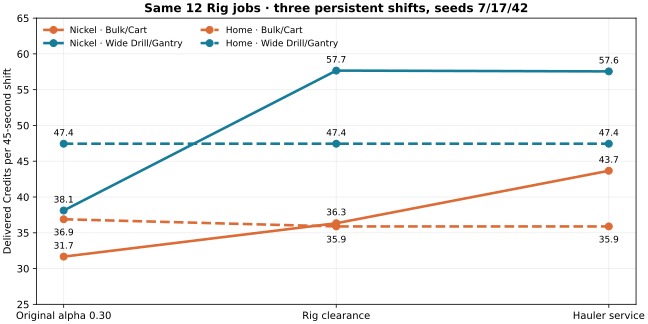

# Hauler service repair · paired follow-up

After the Rig body-clearance repair, Nickel Bulk/Cart on seed 17 still lost income: its Rig reached a full six-item buffer, while the Hauler remained at `(1250, 2732)` with an empty route. Two hardcoded destinations were invalid on that generated map. The idle point `(1315, 2785)` lay only 7.1 units outside an asteroid (the Hauler needs 11); the fixed offset beside the drilling Rig lay inside another rock. Both calls to the route planner returned no path.

The Hauler now chooses a clear standby point near HQ when its preferred spot is occupied, and picks a reachable meeting point within 27 units of a productive Rig. A short negative cache bounds the search when no meeting point is available. A partially loaded field Cart becomes collectible during the final five seconds of mining so that its cargo can return with the Hauler instead of being left beside a Rig that is about to stop. Travel, collision and item ownership remain physical; neither ores nor credits are teleported.

The first controlled comparison reruns the **same 12 Rig jobs**, with two builds, Home Dense and Nickel, seeds 7/17/42, patrols and three persistent 45-second shifts. All 36 resource ledgers balance and no job failed. The source engine fingerprint is retained in `balance-baselines/alpha-0.30-rig-service-screen.json`.

| Region and Rig/Hauler/Fighter build | Original alpha 0.30 | Body-clearance repair | Hauler service repair | Zero shifts after service repair |
|---|---:|---:|---:|---:|
| Home Dense · Bulk/Cart | 36.9 | 35.9 | 35.9 | 0/9 |
| Home Dense · Wide Drill/Gantry | 47.4 | 47.4 | 47.4 | 0/9 |
| Nickel · Bulk/Cart | 31.7 | 36.3 | 43.7 | 0/9 |
| Nickel · Wide Drill/Gantry | 38.1 | 57.7 | 57.6 | 0/9 |



Values are mean delivered Credits over nine shifts, unlike the median-of-seed-means used in the first screen. Nickel Bulk/Cart seed 17 is **43/36/24** Credits after the service fix, versus **18/18/8** after body clearance alone and **44/48/18** in the original alpha 0.30 code. The Hauler delivers **11/6/6** fragments from its hold and **7/2/2** from the physical Cart in the repaired shifts. Seed 42 still has positive Credits in all three shifts (**45/19/52**). The repaired seed 17 total is close to the original, though the second shift remains lower; these three seeds do not settle a universal balance claim.

```sh
npm run balance:lab -- --profile screen --seeds 7,17,42 --shifts 3 --only-builds bulk-cart,rig-gantry --only-fleet rig --out balance-results/rig-service-check --workers 2 --job-timeout 120 --wall-limit 600 --assert
```

An end-to-end seeded regression requires nonzero Hauler and Cart deliveries in all three seed 17 shifts, at least 90 Credits in total and zero ledger errors. The existing seed 42 regression still requires positive delivery in all three previously blocked shifts.

## Complete three-slot screen

The unchanged 114-case protocol also completed on this engine: 19 fleet/build cases × two regions × three seeds, with three persistent shifts per job. **114/114 jobs and all 342 shift ledgers passed**. The compact full dataset is `balance-baselines/alpha-0.30-hauler-service-full-screen.json`; raw timelines remain in the run output.

Compared with the original alpha 0.30 screen, the five Nickel Rig builds improve by **10.7–19.4 mean Credits/shift**, and each loses its three zero-income shifts. Miner-only fleets produce exactly the same results across this deterministic screen. Among all other cases, the largest mean decrease is one Credit/shift, in Home Dense Rig Bulk/Cart and Express/Cart; non-Rig Hauler cases change by between −0.6 and +1.3. These are descriptive paired results from three seeds, not a statistical guarantee for every map.

```sh
npm run balance:lab -- --profile screen --seeds 7,17,42 --shifts 3 --out balance-results/service-full-check --workers 2 --job-timeout 120 --wall-limit 1800 --compare balance-baselines/alpha-0.30-screen-3shifts.json --assert
```

The next balance screen should widen the seed set and compare four-to-six-slot fleets at matched Tech budgets. Check purchase reachability separately with the paid campaign profile before changing costs or income values.
