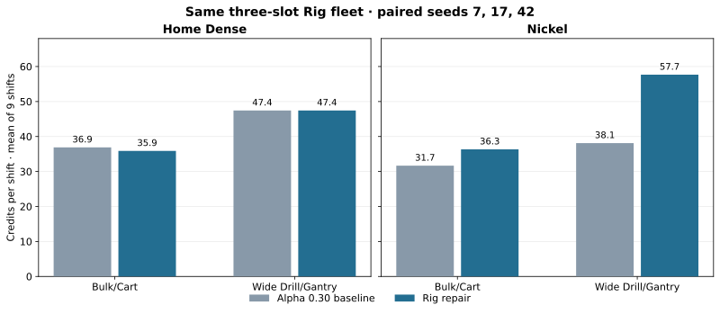

# Rig navigation repair · paired alpha 0.30 follow-up

The alpha 0.30 screen remains the unmodified reference. This follow-up changes only Rig navigation and runs the same 12 Rig fixture jobs (two builds × Home Dense/Nickel × seeds 7, 17, 42), each for three persistent 45-second shifts with patrols. All 36 shift ledgers conserve fragments, and there are no failed jobs. Prices, extraction rate and the Hauler/Cart rules are unchanged.

| Region, three-slot Rig/Hauler/Fighter fleet | Build | Reference mean Credits/shift | Repaired mean | Zero shifts, before → after |
|---|---|---:|---:|---:|
| Home Dense | Bulk/Cart | 36.9 | 35.9 | 0/9 → 0/9 |
| Home Dense | Wide Drill/Gantry | 47.4 | 47.4 | 0/9 → 0/9 |
| Nickel | Bulk/Cart | 31.7 | 36.3 | 3/9 → 0/9 |
| Nickel | Wide Drill/Gantry | 38.1 | 57.7 | 3/9 → 0/9 |



These are means over all nine shifts per case, not the median-of-seed-means shown in the original screen. The individual paired Nickel Bulk/Cart shifts expose a substantial tradeoff: seed 42 changes from **0/0/0 to 51/52/6 Credits**, but seed 17 changes from **44/48/18 to 18/18/8**. In that seed the repaired Rig reaches its six-unit buffer, yet its Hauler does not pick up the load before recall. Do not infer a universal Bulk/Cart income increase from the aggregate. The next balance pass should investigate the approach position and Hauler servicing geometry on seed 17 before adjusting numeric talents.

The quiet diagnostic has no patrols and probes seed 42 at 45, 60 and 90 seconds for three shifts each. Previously it never drilled or earned Credits in any of these nine shifts. After repair, its 45-second shifts yield **51/52/6**, 60-second shifts **52/63/6**, and 90-second shifts **74/76/61**. The quiet seed 17 now yields **18/18/8** at 45 seconds; this independently confirms the servicing regression. Every diagnostic ledger conserves fragments.

The repair gives Rig route masks, edge checks, smoothing and waypoint skipping its 17.2-unit clearance, keyed separately from smaller units. It anchors the chosen working position to the rock for the journey, and after three seconds with less than eight units of movement it briefly excludes an inaccessible rock and selects another. This prevents repeated oscillation against a route the physical 17-unit Rig cannot traverse. The old clearance route remains the reference for smaller units. A seeded regression asserts positive delivered Credits in all three previously blocked 45-second shifts, and a route test checks large-body segment clearance and cache separation.

Reproduce this paired subset after another change:

```sh
npm run balance:lab -- --profile screen --seeds 7,17,42 --shifts 3 --only-builds bulk-cart,rig-gantry --only-fleet rig --out balance-results/rig-follow-up --workers 2 --job-timeout 120 --wall-limit 600 --assert
node --experimental-strip-types scripts/balance-lab/diagnose-rig.ts --out balance-results/rig-quiet-follow-up
```

The versioned files `balance-baselines/alpha-0.30-rig-repair-screen.json` and `balance-baselines/alpha-0.30-rig-navigation-repaired.json` hold the paired results and detailed quiet state traces. The former drops dense trace points, as does the original screen baseline; the latter preserves the original diagnostic's resolution. Use the original `alpha-0.30-screen-3shifts.json` and `alpha-0.30-rig-navigation.json` as the before data. A further full 114-job screen and wider seed sample are needed before general balance changes.
